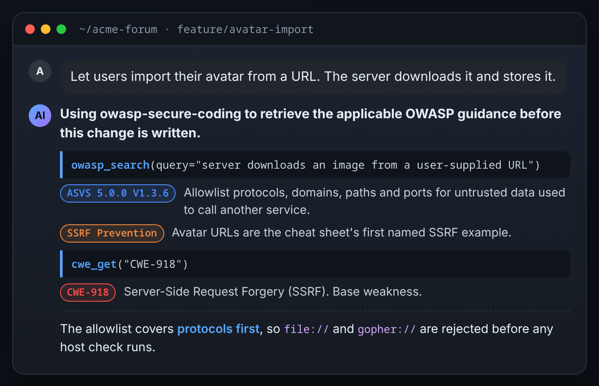
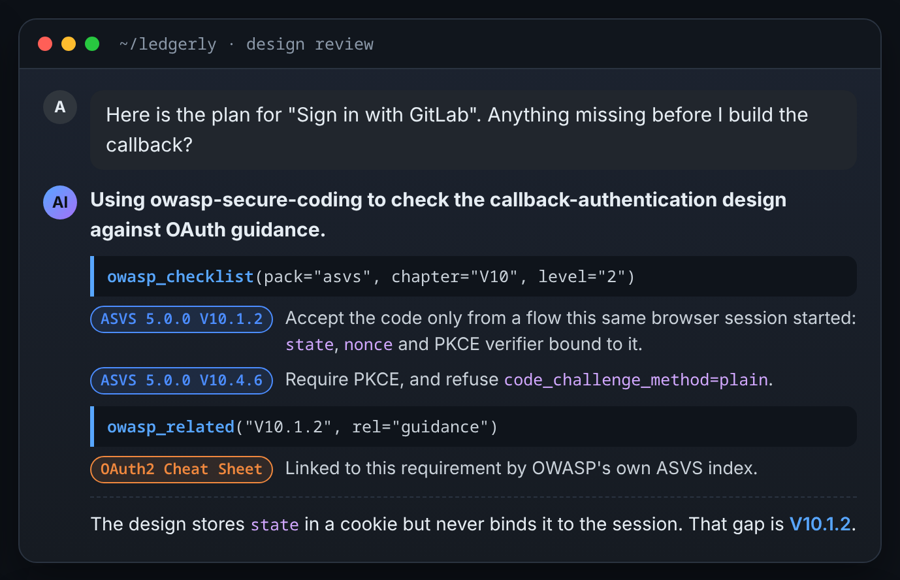
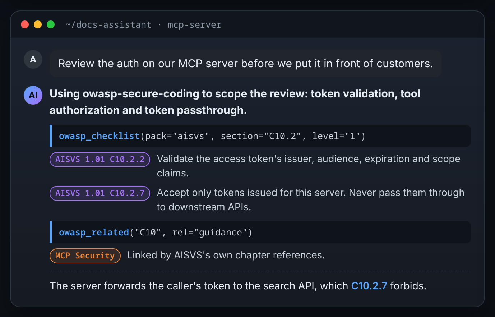
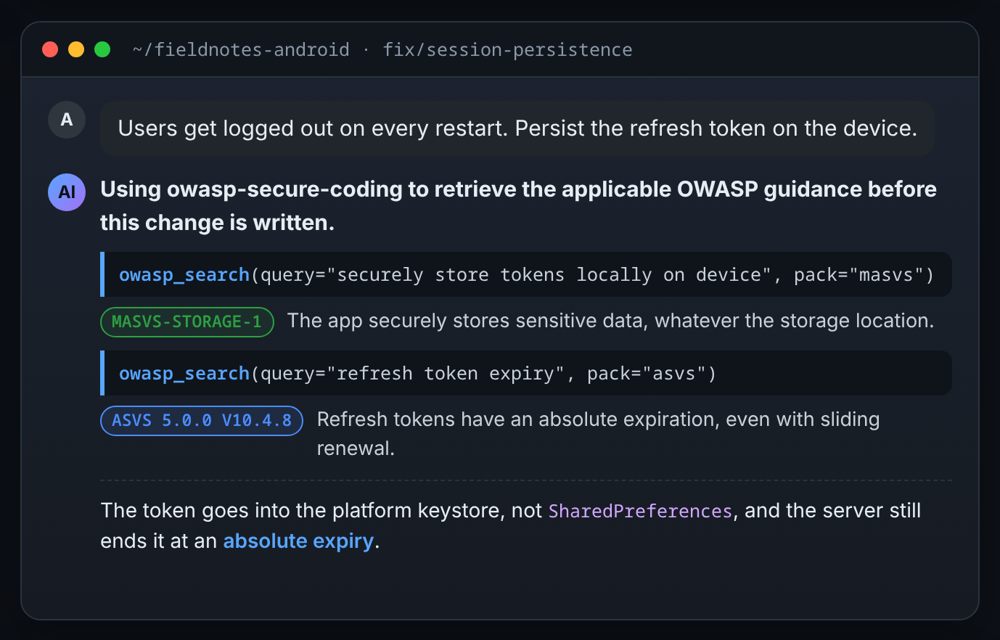
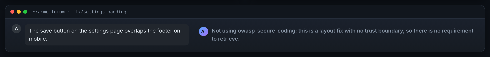

# owasp-kb

[](https://github.com/OWASP/ASVS)
[](https://github.com/OWASP/masvs)
[](https://github.com/OWASP/AISVS)
[](https://github.com/OWASP/CheatSheetSeries)
[](https://cwe.mitre.org/)
[](#http-transports-sidecar-deployments)
[](#runs-offline)
[](LICENSE)

**Your coding agent cites the exact OWASP requirement before it writes the
code, instead of guessing from memory.**

Authoritative OWASP security guidance — ASVS 5.0.0 for web applications, MASVS
2.1.0 for mobile apps, AISVS 1.01 for AI systems, and the Cheat Sheet Series —
plus MITRE's CWE catalogue, served to AI coding agents as an MCP server, with
citations, over stdio, offline.



<sub>An illustrative session, modelled on how agents announce the
`owasp-secure-coding` skill in real work. The project is invented; every
requirement, cheat sheet and CWE id shown is real and was retrieved from the
index. More sessions are under [Ask it](#ask-it).</sub>

This project is not affiliated with, endorsed by, or sponsored by the OWASP
Foundation. See [NOTICE](licenses/NOTICE). **CWE is not an OWASP project** —
it is MITRE's, and it is here because ASVS maps its requirements to CWE ids; see
[docs/licensing.md](docs/licensing.md).

## What it serves

One SQLite index, five pinned upstream sources, cross-linked so an agent can
walk from "what is required" to "how do I do it":

| Pack | Covers | Pinned to | Content |
|---|---|---|---|
| `asvs` | Web applications and their APIs | ASVS `5.0.0` | 345 requirements, levels L1–L3 |
| `masvs` | Android and iOS clients | MASVS `2.1.0` | 24 controls |
| `aisvs` | LLM applications, agents, RAG pipelines, MCP servers, the model lifecycle | AISVS `1.01` | 213 requirements, levels L1–L3 |
| `cheatsheets` | How to implement the controls | Cheat Sheet Series commit `668ba7db` | 137 cheat sheets |
| `cwe` | The weakness behind a finding | CWE `4.20` | 1,391 weaknesses and categories |

The packs link to each other: 187 `guidance` edges from requirements to cheat
sheets, 204 ASVS requirements mapped to CWE, 265 links from 190 ASVS 5.0.0
requirements to the 4.0.3 ids they replace, and 48 NIST SP 800-63B links. Counts are from a
build of the pinned sources on 2026-11-05.

## Ask it

You do not call the tools yourself. The skills trigger on what you are working
on, and the agent retrieves before it answers. The sessions below are
illustrative, and every id in them is real.

**A design review, before the code exists.** The agent walks the OAuth chapter
at your target level and names the requirement the design misses.



**An AI system.** An MCP server, an agent or a RAG pipeline gets AISVS
requirements, not ASVS ones adapted by analogy.



**A mobile client.** Device-side storage gets a MASVS control, and the server
side still gets its ASVS requirement.



**No security dimension.** The skill says so in one line, with its reason, so
you can overrule it.



Two more that need no picture:

- "What do we need for ASVS level 2 on sessions?" → every L1 and L2 requirement
  in the chapter, enumerated, not the best-matching few.
- "Is CWE-1004 the right id for this cookie finding?" → the catalogue entry, or
  an error if the id does not exist.

The page these are cut from is
[docs/assets/showcase/index.html](docs/assets/showcase/index.html).

## Works with

- **Claude Code** — install the plugin: MCP server, four skills, six agents
  and five hooks in one step.
- **Codex** — install the same plugin with `codex plugin marketplace add` and
  `codex plugin add`: MCP server, skills and hooks. The two assessment skills
  need the agents, which Codex does not load yet (#94).
- **OpenCode** — `install/opencode.sh` prints the config snippet. The two
  assessment skills need agents OpenCode does not load (#95).
- **Any MCP client** — stdio by default, or streamable HTTP and SSE for a
  sidecar deployment.

## Why this exists

Ask an agent for secure-coding advice and it answers from training data: no
version number, no citation a reviewer can check, and often a release or two
behind whatever the client's compliance target actually requires. That advice
is frequently right and always unverifiable — there is no way to tell "this
matches ASVS 5.0.0 V6.2.1" from "this sounds plausible."

`owasp-kb` replaces that recall with retrieval. It ships the OWASP Application
Security Verification Standard, the OWASP Mobile Application Security
Verification Standard, the OWASP AI Security Verification Standard, the OWASP
Cheat Sheet Series and MITRE's CWE catalogue,
each pinned to an exact release or commit, chunked and cross-linked into a
single SQLite index, and exposes it over MCP so an agent calls a tool and gets
back a citable requirement id, cheat sheet anchor or CWE id — not a paraphrase
of what it remembers.

The CWE pack is here for one measured reason: of 95 CWE ids cited in findings in
one real assessment, **42 were absent from OWASP's ASVS→CWE mapping**, so nothing
in this server could check them and they were effectively recalled from training
data and asserted. `cwe_get` is what checks them.

The MASVS pack is here because ASVS has no citable answer for a mobile client.
ASVS is written for web applications and their server endpoints, so an agent
auditing a mobile app was adapting ASVS requirements by analogy — a citation
that resolves to a web-scoped requirement, leaving the device-side dimensions
(platform keystore, biometric and local authentication, screenshot/backup/log
leakage, IPC and deep links, resilience) with no id to enumerate. MASVS 2.1.0
gives those dimensions their own citable ids, queried through the same
`owasp_*` tools with `pack="masvs"`.

The AISVS pack is here because neither ASVS nor MASVS covers an AI system.
Prompt injection screening, agent action approval, vector-store tenant
isolation, MCP token validation and training-data provenance had no citable
requirement, so a finding about an MCP server cited ASVS by analogy or cited
nothing. AISVS 1.01 gives them ids like `C10.2.2`, and its levels align with
ASVS's one to one.

## Tools

Ten tools cover search, navigation, checklist enumeration, cross-references
between the knowledge bases, CWE lookup by id, and assembling assessment
verdicts into a checked roster:

| Tool | Purpose |
|---|---|
| `kb_info` | Report which packs are loaded, their pinned versions, and the active retrieval mode (`lexical` or `hybrid`). Call first when unsure what content is available or when a citation needs an exact version string. |
| `owasp_search` | Hybrid (or lexical-only) search across ASVS, MASVS and AISVS requirements and Cheat Sheets for a natural-language security topic. Returns citable hits, never invented ones. |
| `owasp_outline` | Heading structure and section anchors for one document, so a large cheat sheet can be navigated instead of fetched whole. |
| `owasp_get` | Full text of a document, or one section by anchor. |
| `owasp_checklist` | Enumerate requirements from a checklist pack (`asvs`, `masvs` or `aisvs`) filtered by chapter, section, id, or level — the tool for assessments and gap reports that need every applicable requirement, not the best-matching few. |
| `owasp_related` | Cross-reference a requirement, section, chapter, or cheat sheet doc_key across `guidance`, `cwe`, `supersedes`, and `nist` relationships. |
| `cwe_get` | Look up one CWE weakness or category by id — name, abstraction, status, description. Call it before citing an id OWASP's mapping does not carry; an id that is not in the catalogue is an error, not an empty result. |
| `cwe_search` | Search the CWE catalogue by describing a defect in your own words, for when you know what the weakness is but not which CWE names it. OWASP's mapping is silent for 141 of 345 requirements. |
| `cwe_related` | Parents, peers, or a category's members for a CWE id — and with `ancestors=True`, the whole `ChildOf` chain with each node's abstraction, for comparing a self-chosen id against the mapped one. |
| `owasp_roster` | Assemble an assessment's verdicts into a complete, checked roster — every requirement lands in exactly one of seven verdicts, and a claim of a checked outcome (a `GAP`, a verified `N/A`, or a refuted gap) is rejected without its adversary's trace. Call this at the end of an assessment instead of tallying by hand. |

Full argument semantics, return shapes, error cases, and worked examples are in
[docs/tools.md](docs/tools.md).

## Skills and prompts

Four skills, installed with the plugin, trigger on the security topics an
agent is about to touch (authentication, sessions, injection, crypto, file
upload, and more — the full trigger list is in
[docs/discoverability.md](docs/discoverability.md)) and mandate a tool call
before any answer:

| Skill | Use when |
|---|---|
| `owasp-secure-coding` | Writing or reviewing code touching a security-relevant area |
| `owasp-asvs-verify` | Running a security assessment, pentest, or code audit against ASVS |
| `owasp-asvs-gap-report` | Producing a compliance report or gap analysis at a target ASVS level |
| `owasp-threat-model` | Reviewing an architecture or design before implementation |

Three MCP prompts ship with the server and surface as slash commands in
Claude Code:

| Prompt | Purpose |
|---|---|
| `asvs_chapter_review` | Walk one ASVS chapter as a verification pass |
| `cheatsheet` | Look up authoritative guidance on a topic and cite it |
| `asvs_gap_report` | Produce a complete gap report at a target level |

## Two variants

| Image | Retrieval | Index |
|---|---|---|
| `owasp-kb:lite` | BM25 (lexical) | 8.0 MB |
| `owasp-kb:full` | Hybrid (BM25 + vector, RRF-fused) | 16.0 MB |

Index sizes are measured from the shipped files in `dist/`. The image sizes
previously quoted here (246 MB and 692 MB) were measured before the CWE pack
joined the index and are now understated by roughly the index growth; they are
omitted rather than restated, because nobody has rebuilt and measured them since.
The embedder remains the bulk of the difference between the two images (~446 MB).

Hybrid also measurably improves ranking: mean rank of the expected document
across four paraphrased queries is **3.2 (lexical) and 2.2 (hybrid)** on the real
corpus. The lexical figure was 3.0 before the CWE pack was ingested: 1,391 more
documents in the BM25 index cost exactly one rank position on one of the four
queries (the four ranks sum to 13 where they summed to 12), so the gap the
embedder closes is slightly wider than it was, not narrower. See
[docs/architecture.md](docs/architecture.md) and ADR
[0004](docs/decisions/0004-lite-and-full-variants.md) for the full measurement and
how the acceptance bar was corrected along the way; the ADRs record 3.0 because
that is what was measured when they were written.

## Install

The repository and its images are both **private**, and they are separate grants:
SSH access to the repository does not authorise the registry. You need both.

```
docker login ghcr.io          # a GitHub PAT with the read:packages scope
```

**Claude Code:**

```
/plugin marketplace add git@github.com:Crimson7research/owasp-kb.git
/plugin install owasp-kb
```

That registers the MCP server and installs four skills, six agents and five hooks.
The server runs `ghcr.io/crimson7research/owasp-kb` pinned by digest, so the first
start pulls the image (~700 MB for `full`) and later starts use the local copy.

Check the whole chain — plugin, pin, registry access, server, hooks, state
directory, SSH — with the host CLI. It ships in the plugin's `scripts/`, off
`PATH`, so it is invoked by absolute path; `<scripts>` is the absolute directory
the owasp-kb session-start note names, which that note states in every session:

```
python3 <scripts>/owasp-kb doctor
```

**Any MCP-capable agent.** The image reference is the digest in
`plugins/owasp-kb/.mcp.json`; `install/opencode.sh` reads it from there and
prints the config snippet for OpenCode, so it needs no editing per release.
Codex installs the plugin itself; see [docs/install.md](docs/install.md#codex).

```
./install/opencode.sh
```

**Building from source** is the contributor path, not the install path — see
[docs/build.md](docs/build.md). `make build` produces `owasp-kb:lite` and
`owasp-kb:full` locally; point the plugin at one with `OWASP_KB_IMAGE`.

Full commands for every path, what an assessment leaves on your machine, and a
troubleshooting table are in [docs/install.md](docs/install.md).

## Runs offline

Every server invocation above passes `--network none`. That is not a default
worth reconsidering — the index is baked into the image at build time, so the
server needs no network access to answer anything, and none is granted. On a
client security engagement this matters directly: the tool never has an
egress path for the codebase being reviewed, works inside networks that are
deliberately locked down, and needs no allowlisting exception to pass a
client's own security review before it can be used on their systems.

## HTTP transports (sidecar deployments)

The stdio transport above is the default and what the plugin uses. For a
container deployment where the consumer cannot spawn the server as a subprocess
— a sidecar on an internal Docker network — the same server also serves HTTP:

```sh
owasp-kb-server --transport streamable-http   # POST /mcp
owasp-kb-server --transport sse               # GET /sse + POST /messages/
```

`--host` and `--port` (defaults `0.0.0.0:8000`) control the bind address. Each
of the three settings also reads an environment variable — `OWASP_KB_TRANSPORT`,
`OWASP_KB_HOST`, `OWASP_KB_PORT` — with a CLI flag overriding the environment,
the same precedence `OWASP_KB_INDEX` already follows. Containers are configured
by environment, which is why the env vars exist.

An HTTP server is a listening surface, so the boundary moves: bind to an
internal network or localhost, never a public one, and front it with whatever
auth the deployment already has. There is no authentication built into either
HTTP transport. `--network none` remains correct for every stdio use.

## Reproducible citations

Standard `:lite` and `:full` tags move as sources are refreshed. Every release
also gets an immutable tag encoding the exact pinned content, for example
`owasp-kb:full-asvs5.0.0-cs20261004-cwe4.20-masvs2.1.0-aisvs1.01` — ASVS release
`5.0.0`, Cheat Sheet Series pinned at the commit dated `2026-10-04`, CWE release
`4.20`, MASVS `2.1.0` and AISVS `1.01`. A citation
produced against that tag (`ASVS 5.0.0 V6.2.1`, or `CWE-789`) resolves to the same
text for as long as the image exists, independent of whatever `:full` points to
later.

The `-cwe<version>` component was added with the CWE pack. Without it a CWE
release bump — which deprecates ids and renumbers others — would have produced a
byte-different index under an identical tag, which is exactly the failure the
immutable tag exists to prevent. ADR 0003 and 0004 quote the older two-pack tag
form because that is what existed when they were written.

## Documentation

| File | Covers |
|---|---|
| [docs/architecture.md](docs/architecture.md) | Component diagram, the four units (`ingest/`, `core/`, `server/`, `plugin/`), schema, the `links` edge table, chunking rules |
| [docs/kb-packs.md](docs/kb-packs.md) | The pack contract, `checklist` vs `corpus`, and how to add a pack |
| [docs/tools.md](docs/tools.md) | Every tool's signature, arguments, return shape, errors, and a worked example |
| [docs/discoverability.md](docs/discoverability.md) | Why tool descriptions and skills are trigger-worded, and what was rejected |
| [docs/build.md](docs/build.md) | Lock file format, `make` targets, CI workflows, image tag scheme, mapping coverage |
| [docs/install.md](docs/install.md) | Every install path with exact commands, plus troubleshooting |
| [docs/licensing.md](docs/licensing.md) | The CC-BY-SA-4.0 / MIT split in full, CWE's own terms of use, and what a redistributor must do |

Design decisions — including the SQLite-over-Postgres call, the baked-index
trade-off, and why the project is Python — are recorded as ADRs in
[docs/decisions/](docs/decisions/).

## Licensing

Code is MIT (see [LICENSE](LICENSE)). The ASVS, MASVS, AISVS and Cheat Sheet
Series content, and the SQLite index built from it, are CC-BY-SA-4.0 (see
[licenses/](licenses/), one text per pack). The CWE catalogue is MITRE's, under
the CWE Terms of Use, which must accompany redistribution (see
[LICENSE-CWE](licenses/LICENSE-CWE)) — `CWE™` is a MITRE trademark and naming
the catalogue is attribution, not endorsement. See
[docs/licensing.md](docs/licensing.md) and [NOTICE](licenses/NOTICE) for what
all three mean for anyone redistributing this project or its images.
